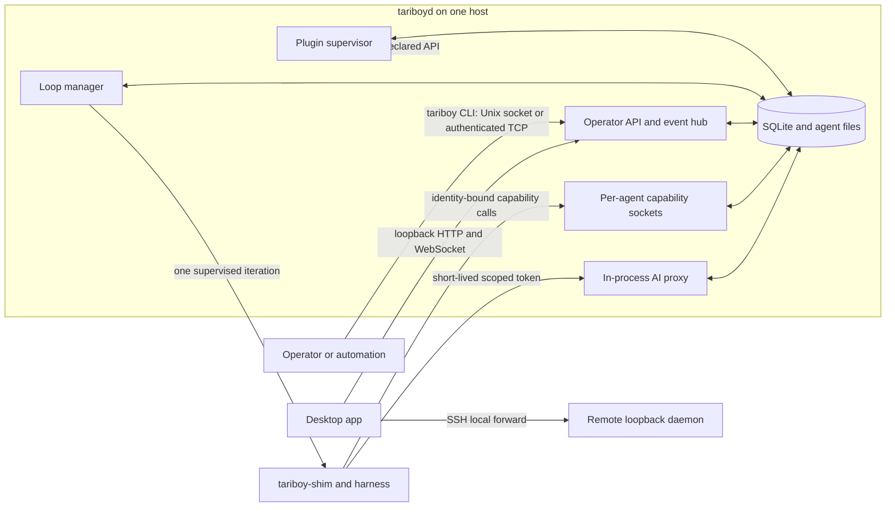
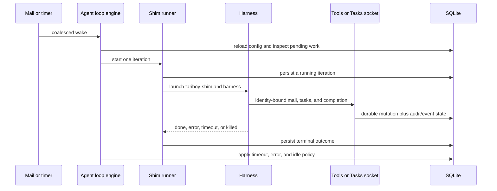
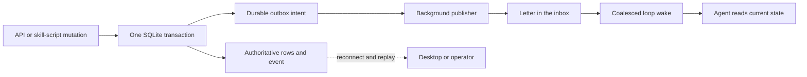

## The daemon (`tariboyd`)

`tariboyd` is the long-running process at the center of the system
(`cmd/tariboyd`, `internal/daemon`). It owns:

- the **agent lifecycle** — create, start/stop the loop, run iterations, reap;
- the **mailbox** — letters between agents, the customer, plugins and daemon components;
- **native Tasks** — queues, recursive task trees, comments, dependencies,
  per-agent sticky goal selection, agent pools, queue triggers, events, and a
  durable notification outbox;
- the **SQLite store** — `tariboyd.db`, all durable state;
- the **plugin supervisor** — spawns, health-checks, and restarts plugins;
- the **AI proxy** — every LLM call flows through it;
- API and WebSocket surfaces for clients. The Desktop UI is shipped by Tauri,
  not embedded in the daemon.

## System context and trust boundaries

The daemon is the one durable control plane on a host. Desktop and the
operator CLI are clients; harnesses are supervised workers; plugins are
supervised integrations. None of them owns a second copy of product state.



| Surface | Typical client | Boundary and identity |
| --- | --- | --- |
| Operator API | Desktop, CLI, automation | Unix socket by default; a TCP listener requires the configured bearer-token policy. The optional HTTP/WebSocket listener accepts loopback addresses only. |
| Agent capability socket | Skill-local scripts plus the legacy `tasks` and `i-am-done` compatibility shims | One Unix socket per agent. The daemon derives the agent and current iteration, so request JSON cannot impersonate another caller. |
| AI proxy | Harness or plugin making an LLM request | Loopback listener plus a short-lived iteration- or plugin-scoped token. Upstream provider keys remain in the daemon. |

The Android app has no daemon of its own. It reaches a daemon through a port
the user forwards to the phone's loopback, or through an HTTPS server, and the
loopback listener allows its origin `http://tauri.localhost`.

Remote Desktop access is an SSH local-forward to the remote daemon's loopback
listener. System OpenSSH retains host-key verification, agent forwarding,
ProxyJump, and interactive authentication. See [Security and
controls](/docs/security-controls) for the full transport and credential rules.

## Components and ownership

| Component | Owns | Does not own |
| --- | --- | --- |
| Store and migrations | `tariboyd.db`, configuration, agent/task/message records, and durable outboxes | UI state or a second in-memory source of truth |
| Agent store and loop manager | Agent configuration, per-agent engines, iteration adoption, shim refresh, and orphan-session reaping | Harness business logic |
| Loop engine and shim runner | At most one iteration per agent, prompt preparation, timeouts, completion, and process supervision | Task state rules |
| Image store and builder | Built plugin/prompt artifacts addressed by ref id, source provenance, runnable import/export, and Store path resolution | Harness/model/runtime policy or editable source snapshots |
| Mail | Letters, recipient checks, inbox caps, attempts, dead letters, and the wake and hint hooks | Direct process-to-process delivery guarantees |
| Native Tasks service | Queues, task trees, comments, relations, pools, triggers, notifications, workflow bindings, queue secrets, transition requests, and script run records | Agent authentication or running script processes |
| Workflow script worker | Executing pending check and watch runs: environment, working directory, process group, timeout, run log, and result parsing | What a verdict means for the task |
| Plugin host | Plugin process lifecycle, plugin tokens, and delivery of each plugin's inbox to its `/deliver` | Provider credentials in plugin environments |
| AI proxy and pricing catalog | Provider routing, scoped tokens, budgets, immutable request costs, daily model-price refresh, usage, and transcripts | Durable provider keys or proxy leases in SQLite |
| API and event hub | Command registry, REST responses, and resumable event hints | State changes outside their owning services |

The daemon creates a shared audit recorder for each agent. Loop lifecycle
entries, mail actions, proxy decisions, and shim log tails therefore describe
one coherent agent timeline, while a WebSocket event remains only a replayable
delivery hint.

## Directories

Path resolution lives in `internal/paths`:

- **Data dir** — `$TARIBOY_BASE_DIR`, else `~/.tariboy`. Holds the DB,
  agent working dirs, built images, and side-by-side external plugin
  versions.
- **Runtime dir** — `$TARIBOY_RUNTIME_DIR`, else `~/.tariboyd`. Holds the
  control socket (`tariboyd.sock`), pidfile, and log.

Operator `PUT /api/files` (`files upload`) accepts a file `name` and base64
`content`, stores up to 16 MiB decoded under `files/<unique-directory>/<name>`
in the data directory, and remains available for compatible clients. Desktop
Send files, Attach, terminal-drop, and `tariboy cp` instead stream raw bodies up
to 1 GiB through `PUT /api/files/raw?name=...`. Both routes return `path`,
absolute `abs`, and `bytes`.
These uploads belong to the server independently of agents and tasks; agents
on the same server can read the returned absolute paths. The former
agent-scoped PUT route and `agent push` command are removed. Uploads
are ordinary owner-only files, excluded from support bundles, with no automatic
retention. The server rejects path components and control characters in names
and confines filesystem operations with `os.Root`. The raw route rejects a
declared oversized body before reading it, also bounds unknown-length streams,
and removes its partial file and unique directory after any failed upload.

The data directory also holds each agent's working/configuration files and
iteration evidence. SQLite owns agents, iterations, mail, tasks,
idempotency keys, and durable outboxes. The
global agent shell script is the deliberate filesystem-backed exception:
`<base-dir>/global-agent-shell.sh`; an agent may additionally have
`<base-dir>/agents/<name>/agent-shell.sh`. Both are owner-only files, written
atomically after Bash validation, rather than SQLite configuration.
The owner-only proxy handoff file (`aiproxy-handoff.json`) intentionally sits
outside SQLite, audit logs, and support bundles because it contains active,
short-lived proxy leases required to adopt live harnesses after restart.
The same data directory contains `model-prices-litellm.json`, an owner-only
cache of validated external pricing data. SQLite remains authoritative for the
managed price rows derived from that cache. The cache is also excluded from
support bundles; see [Security and controls](/docs/security-controls#pricing-catalog-boundary).

## Startup, execution, and shutdown

```mermaid
sequenceDiagram
  participant O as OS or daemon command
  participant D as tariboyd
  participant S as SQLite
  participant M as Loop manager
  participant P as Plugins and AI proxy
  participant C as Clients

  O->>D: start with paths and listener options
  D->>D: resolve PATH, paths, socket guard, and PID file
  D->>S: open database and run migrations
  D->>D: rebuild the bare image for this release and ensure proxy defaults
  D->>D: read and validate local model-price cache
  D->>S: replace managed price rows when the cache is valid
  D->>M: refresh shims; adopt and reconcile live iterations
  D->>P: bind proxy and prepare plugin host
  D->>D: refresh stale prices without blocking clients; run background workers
  D->>C: bind the API listener and optional HTTP/WS listener, then serve them
  O->>D: cancellation, controlled stop, or a listener failure
  D->>C: stop API listeners, then the proxy, and wait for them
  D->>D: cancel and drain background workers
  D->>M: stop plugins, then managed loops and capability servers
  D->>S: flush and close durable state
```

`daemon.Run` (`internal/daemon`) is a short sequence of phases, each in its own
function with a typed result: process setup (logger, `PATH`, paths, the socket
guard and PID file), store and telemetry, tasks, AI proxy, plugins, loop
manager, runtime start, background workers, and serving. Each phase pushes the
stop of every resource it creates onto one shutdown stack right after it
creates the resource. The stack runs last-pushed first on every return path, so
a resource always stops before the resources it uses. The order is:

1. API servers (Unix socket or TCP, and the HTTP/WS listener), awaited.
2. The access log.
3. The AI proxy, awaited.
4. Background workers, canceled and awaited.
5. Running operations (image and workflow builds), canceled and awaited; each
   records the status `interrupted`.
6. Plugins, then the loop manager.
7. Telemetry flush, then the SQLite store, then the PID file.

All listeners bind before the daemon reports itself started, so a busy HTTP
port fails startup synchronously. If any API listener fails later, the daemon
takes the same path as a controlled stop: every server is shut down and its
goroutine awaited before the manager and the store stop. An embedder or an
in-process test can pass `Options.Ready`; the daemon calls it once all
listeners are bound and the workers run.

The daemon fails before serving if it cannot prepare the data directory, bind a
safe socket, detects an already-live Unix daemon, cannot parse the requested
listener, or receives a non-loopback HTTP address. A shim refresh failure is
logged for its agent without preventing unrelated agents from starting.

In steady state it runs the schedule publisher, the task notification outbox
publisher, the per-agent goal reconciler, the queue-trigger ingress reconciler,
the workflow script worker, AI ingestion, the daily pricing
catalog worker, budget cache refresh, nightly database
maintenance (backup, iteration pruning, cleanup, compaction; see
[State model](/docs/architecture/state-model#nightly-backup-and-data-retention)),
loop engines, and plugin supervisors.

The workflow script worker (`internal/workflowrun`) executes the check and
watch scripts of workflow tasks. Before it starts, the daemon records every run
that was still `running` as `interrupted`. The worker wakes on task changes,
when a run finishes, and every two seconds; it schedules due watches, kills runs
whose cancellation was requested, and starts pending runs, at most four at once
and never two of one task. Each run is its own process group under the daemon
account, with no agent tools socket. The tasks service decides what a finished
run means in one transaction. On shutdown the worker kills its scripts and
leaves their records `running` for the next start to mark `interrupted`. See
[Task workflows](/docs/task-workflows#script-protocol).

### Background operations

An image build and a workflow build are operations (`internal/operations`).
`POST /api/images/build` and `POST /api/workflow-images/build` check their
arguments in the request. An argument error answers at once with its error
code. Otherwise the daemon records the operation, starts the build on the
daemon's context, not on the request's context, and answers at once with
`{operation}` in the status `running`. A client that disconnects does not stop
the build. With the argument `wait: true` the request answers only when the
build ends: the finished operation, or the build error with its code. Compose
and Store automatic builds use `wait`.

Each operation writes its log to `<base-dir>/operations/<id>.log`: the build
steps, the output of `npx skills experimental_install`, the wait for the image
name lock and the result or the error. Each status change and each log line
emits an `operation` event. Clients read operations with these routes:

| Route | Result |
| --- | --- |
| `GET /api/operations?page=N&limit=M` | One page, newest first, and the total. `limit` is 1 to 200, 50 by default. |
| `GET /api/operations/{id}` | One operation with its result or error. |
| `GET /api/operations/{id}/log?offset=N` | Up to 1 MiB of the log from byte `offset`, the next offset, the log size and whether the operation ended. |
| `GET /api/operations/{id}/log/download` | The whole log file. |
| `GET /api/operations/ws` | A hint frame `{id, status, ts}` for each `operation` event. The client then reads the operation and the log over HTTP. |

The daemon cannot cancel an operation. A daemon stop interrupts running builds,
and the next start marks rows that are still `running` as `interrupted`. An
image build that fails restores the previous image tags, so an interrupted
build leaves no partial image.

Shutdown stops the API listeners and the proxy first, then cancels and awaits
the pricing worker and the other workers before plugins, loops and SQLite stop.
That ordering prevents a request, a catalog publication, a final outbox, or a
usage write from racing a closed database.

## Harness model catalog

`GET /api/harnesses/{type}/models` (CLI: `tariboy harness models TYPE`) returns
`{harness, models: [{id, label, efforts}], efforts, error}` for one harness as
installed on the daemon host, so Desktop asks the host the agent will run on,
including a remote one behind its SSH tunnel. The daemon runs the harness CLI
in its own environment:

| Harness | Source |
| --- | --- |
| Claude Code | Fixed list: `fable`, `opus`, `opus[1m]`, `sonnet`, `haiku`; efforts `low`, `medium`, `high`, `xhigh`, `max` (the CLI has no model list command) |
| Codex CLI | `codex debug models`: models with `visibility: list`, each with its `supported_reasoning_levels` efforts |
| Cursor CLI | `agent models`: `id - Name` lines; no separate effort list |
| OpenCode | `opencode models`: one `provider/model` per line; no effort list |

Each run is bounded to 20 seconds and 4 MiB of output. A successful catalog is
cached in daemon memory for five minutes per harness; `refresh=true` (CLI
`--refresh`) asks the CLI again. A missing, failing, or unparseable CLI still
answers HTTP 200 with empty lists and an `error` text; only an unknown harness
is a `bad_harness` request error. The catalog reflects the daemon environment,
not an agent's own environment overrides such as a different `CODEX_HOME`, and
`codex debug models` may refresh its catalog over the network with the
account's login.

## Managed model-price lifecycle

The daemon owns one model-price catalog sourced from LiteLLM's fixed published
HTTPS document. Startup synchronously reads the local cache because that read
is bounded and does not use the network. A missing, stale, or rejected cache
does not prevent the proxy from becoming ready: built-in fallback prices and
operator-managed overrides remain available, while a missing or 24-hour-old
cache triggers a network refresh in the background. The same awaited worker
checks again every 24 hours until daemon shutdown.

A refresh validates the complete candidate before changing published state.
It atomically replaces the owner-only cache, replaces only `litellm` database
rows in one transaction, and finally swaps the complete in-memory generation.
Those ordered recovery points ensure requests see one full generation. If
database publication fails after the cache rename, the active runtime
generation remains unchanged and the next startup reconciles the valid cache.
See [AI proxy and audit](/docs/architecture/ai-proxy#pricing-catalog-and-request-costs)
for source precedence, request accounting, and diagnostics.

## Agent iteration and durable delivery

An agent has one on/off switch, **enabled**, set by Start and cleared by Stop;
**interactive** is a separate setting for the Terminal session. The loop engine
launches autonomous iterations only while the agent is enabled, carries no stop
policy `error_reason`, and does not use the terminal-only `bare:latest` image.
Its loop engine serializes work: a timer, explicit trigger,
or a letter in its inbox may request work, but only one iteration
runs at a time.



Message-triggered work requires an enabled loop and an open letter in the
agent's inbox, but no positive timer interval. Open letters enter the prompt
in bounded batches, requests before notices. A request closes only when the
agent replies to it; a notice closes only after an iteration that ends
`done`. Any other outcome, including `no_i_am_done`, a harness error, a
timeout, or a kill, leaves both open for redelivery. See [Agents and the iteration
loop](/docs/architecture/iteration-loop) and [The shim](/docs/architecture/shim)
for the detailed scheduler and watchdog behavior.



## Failure, recovery, and observability

| Condition | Automatic behavior | Evidence or operator action |
| --- | --- | --- |
| Daemon restart during a live shim | Replacement daemon adopts persisted running iterations and proxy handoff leases. It reaps a tmux session only when no live iteration owns it. | Inspect agent/iteration state and audit; never start a second daemon against the same base directory. |
| Harness timeout or error | The shim records a terminal outcome; loop policy may restart or stop future work. Open letters render again. | Review result, shim logs, audit, and agent loop policy. |
| Plugin failure | The host health-checks and restarts enabled plugins; open letters to a plugin are delivered again. | Inspect plugin status/logs; never place upstream AI credentials in plugin configuration. |
| Model-price refresh failure | The proxy keeps the last valid runtime generation, or built-in fallbacks when none has loaded. The next daily check retries. | Inspect `pricing_catalog_error` daemon logs/events; fields are bounded to source, generation time, model count, and a stable error class. |
| Missed notification or daemon crash | The durable outbox and the ingress reconciler replay pending intent; task state remains in SQLite. | Inspect task event history; the publisher retries on its own. |
| Budget denial | Proxy rejects/reports before provider access and records usage/audit evidence. | Inspect usage, budgets, and the sensitive per-iteration transcript. |

Structured daemon logs, per-agent audit JSONL, iteration results, task
events, usage records, and optional OpenTelemetry signals make the system
observable.

The daemon writes two logs in its runtime directory (`~/.tariboyd` by
default). `tariboyd.log` is the application log: the launcher sends the
daemon's stdout and stderr to it. It has startup lines, warnings and errors,
and one `WARN` line `slow or failed http request` for each API request that
takes 500 ms or more or ends with a 5xx status. WebSocket and SSE requests stay
open by design and are not slow requests. `tariboyd.access.log` has one JSON
line for every API request: method, path, status and `dur_ms`. The daemon
rotates the access log at 50 MB and keeps three old copies
(`tariboyd.access.log.1` is the newest). The CLI and Desktop launchers move a
`tariboyd.log` that is larger than 50 MB to `tariboyd.log.1` before they start
a daemon. `tariboy daemon logs` shows only `tariboyd.log`.

The daemon has one SQLite writer connection for all writes. The reads that the
UI polls — daemon status, the agents list, the mailbox, the task list and
the image list — use a separate pool of four read-only connections. WAL mode
lets those reads see the last committed state while a write is open, so they do
not wait behind the writer. OTLP stays off until an endpoint is explicitly configured. Proxy
transcripts are sensitive data and support bundles intentionally exclude them.

## Key daemon flags

- `--base-dir` — override the data dir.
- `--listen` — `unix` | `unix:/path.sock` | `tcp:HOST:PORT`.
- `--auth-token-file` — required for non-loopback TCP.
- `--http-addr` — loopback JSON API/WebSocket listener; pass `""` to disable
  it. `--web-addr` remains a deprecated compatibility alias.
- `--log-level`, `--version`.

## Command registry

Every operator command is one `registry.Command` in `internal/commands`. The
CLI parser, the daemon HTTP router, `--help-json` and `/api/openapi.json` are
all derived from it.

- **Arguments are bound once.** `registry.Call` runs `registry.Bind` before a
  handler: a missing required argument is answered `400 missing_param`, and a
  value of the wrong type (`"abc"` for a number, a number for a string) is
  answered `400 invalid_param`. The HTTP router, the CLI, plugin commands and
  internal callers all go through it. An empty query value such as `?limit=`
  counts as omitted for a number or a boolean. An argument with an OpenAPI
  `Schema` keeps the shape it was sent in, and undeclared keys pass through.
- **Handlers read typed values.** A handler receives `registry.Request` with
  the transport context and the bound `Params`, and reads them through the
  accessors in `internal/registry/params.go` (`String`, `Trimmed`, `Int`,
  `Bool`, `Strings`, `Has`, `Decode` and the optional forms). A guard test
  keeps raw map assertions and local coercion helpers out of
  `internal/commands`.
- **Errors map once.** `internal/api/errors.go` maps a domain error to its
  HTTP answer for both the operator API and the per-agent capability socket:
  `api.UserError` and `*tasks.Error` carry their own status, a parameter error
  is `400`, not-found sentinels are `404`, script state conflicts are `409`.
  Any other error is `500 internal` with a fixed text, and its detail goes only
  to the daemon log. Both servers decode JSON bodies with the same size limit
  and a fixed `bad_json` text.
- **Some commands run in the CLI.** A command with `Local` runs in the CLI
  process instead of over HTTP: `daemon start|stop|restart|status|logs`,
  `update`, the `compose` verbs, `image build`, `workflow build`,
  `operation ls` and `operation log`. `daemon status`, the build verbs and the
  operation verbs also keep their HTTP routes; the CLI side of a build starts
  the operation and reads its log over the socket.
  `AbsPathArgs` names the path arguments the CLI makes absolute, and
  `ExitCodeFrom` derives the CLI exit code from a result.
- **Results are typed Go structs.** A handler returns a named struct, never
  `map[string]any`, and the command declares it with
  `registry.WithResult[T](registry.Command{...})`. The helper derives the JSON
  Schema of `T` with `github.com/invopop/jsonschema`, adds `T` and every named
  struct it reaches to `Schemas` under its Go type name, and sets
  `ResultSchema` to `{"$ref": "#/components/schemas/T"}`. For a slice of a
  named struct, such as `[]StoreView`, `ResultSchema` is an array of that
  reference. `/api/openapi.json`
  copies `Schemas` into `components.schemas` and puts `ResultSchema` under
  `result` in the `200` envelope. The rules follow `encoding/json`:
  - the `json` tag names a property;
  - a field without `omitempty` is required, a field with it is optional;
  - a pointer field must carry `omitempty`, or registration panics;
  - every struct schema has `additionalProperties: false`;
  - an embedded struct adds its fields to the parent;
  - an enum is a string type whose `JSONSchemaExtend` method sets `Enum` from
    its Go constants;
  - a value that can be JSON `null`, such as a nil slice, carries
    `jsonschema_extras:"nullable=true"`;
  - a result whose shape the code does not own, such as a plugin's action
    result or the daemon config keyed by config name, is a named struct with
    a `MarshalJSON` method that keeps the wire format and a `JSONSchema`
    method that describes the open shape.

  Two different schemas under one component name in one command also panic at
  registration. Every command in `internal/commands` uses this form. The
  result types of a domain are in its `*_types.go` file, for example
  `agents_types.go`. The task commands in `tasks.go` name their result types
  in the `taskResultTypes` table. The field descriptions and enums of the
  `internal/tasks` types come from `jsonschema:"description=..."` tags and
  `JSONSchemaExtend` methods. No command has a hand-written `ResultSchema`.
- **The spec is a checked contract.** These tests in `internal/commands` keep
  `/api/openapi.json` and the code together:
  - `TestHTTPCommandsDeclareResultSchema` fails for an HTTP command whose
    `ResultSchema` is not a component reference or an array of one. There is
    no exception list.
  - `TestCommandsReturnNoRawMaps` (`result_guard_test.go`) parses the
    package's non-test files and fails for a function with the handler result
    `(any, error)` that returns a `map[string]any` literal,
    `make(map[string]any)`, or a variable filled from one.
  - `TestCommandsDeclareConsistentComponents` fails when two commands declare
    one component name with different schemas. Give result types a domain
    prefix, such as `StoreView`, not a generic name such as `Item`.
  - `TestOpenAPISnapshot` compares the served spec with the committed
    snapshot `internal/commands/testdata/openapi.json`. The snapshot pins
    `info.version` to `snapshot`, so a release does not change it. A contract
    change is a change with an updated snapshot. Rewrite it with
    `go test ./internal/commands -run TestOpenAPISnapshot -update-openapi`
    and commit it with the code.
  - `TestTypedResponsesMatchOpenAPI` sends a request to every operation whose
    result is a component reference or has properties, and validates the
    response against the served spec with
    `github.com/santhosh-tekuri/jsonschema/v6`. A new typed operation needs a
    call in its table or in its domain's `typedCallSets` entry, or the test
    fails. The check finds a result that differs
    from its declared type: an extra field, a missing required field, a wrong
    type, or `null` where the schema does not allow it. Error responses are
    validated against the `default` error envelope.
  - `TestDaemonOpenAPIContract` runs only from
    `scripts/tariboy-tasks-e2e.sh`. It reads the spec of the isolated daemon,
    compares it with the snapshot apart from `info.version`, and validates the
    daemon's answers to typed `GET` routes.

  The spec stays OpenAPI 3.0.3. Before validation, the tests rewrite
  `nullable: true`, which JSON Schema does not know, into a type and enum that
  allow `null`.

Native task commands have one more table: `internal/tasks/wire.go` declares
each task action's request struct, CLI words, flags and operator route. The
`ttasks` parser, the operator HTTP decoder and the agent socket decoder are
all built from it, so a new flag is one tagged field.

## Version reporting

Every HTTP response from the daemon — the operator API and per-agent capability
socket alike — carries the daemon's build version in the `X-Tariboy-Version`
response header. It is stamped by one wrapper around each server's handler, so
successes, error envelopes and 404s all carry it; clients never need a dedicated
version route.

The daemon never refuses a request over a version difference: an older client
must keep working against a newer daemon. The header is diagnostic only — the
reaction to a mismatch belongs to the client, see
[Binaries & commands](/docs/binaries).

## Agent bin shims

Provisioning writes only the compatibility shims enabled by the image into
`<data dir>/agents/<name>/bin`: `i-am-done` and the legacy `tasks` shim. The
real `tariboy-tasks` executable is installed globally as `ttasks`. At startup,
a packaged daemon also atomically refreshes one shared `bin/ttasks` symlink in
its runtime directory to its sibling payload and prepends that directory to
the resolved account `PATH`. Fresh Desktop agents therefore have `ttasks`
before optional CLI installation; no agent-local `ttasks` shim is created.
The runtime alias remains across daemon restarts for surviving iterations.
An explicit agent `PATH` override must retain a Tasks command location. When
`TARIBOY_TOOLS_SOCKET` is non-empty, it uses that identity-bound socket and
fails closed; when absent, it uses the host Unix daemon socket as the customer
actor. Each compatibility shim `exec`s its owning skill script by an **absolute
path** inside the active image bridge. Every other capability is invoked
through its packaged skill-local `scripts/*.sh` launcher.

The launch gate validates that each required launcher exists inside the
candidate image, is regular, and is executable before replacing the current
bridge or shims. Failure leaves the previous image and its shims active.

Lifecycle is normally driven through the `tariboy daemon` subcommands rather
than launching the binary directly. See
[The operator CLI](/docs/binaries/operator-cli).

## Read on

<CardGroup>
  <Card title="Agents & the iteration loop" href="/docs/architecture/iteration-loop" icon="repeat">
    What an iteration is, how the loop wakes, and the whoami / loop / mail
    core.
  </Card>
  <Card title="The mailbox" href="/docs/architecture/messaging" icon="mail">
    Letters between principals, requests and notices, and redelivery.
  </Card>
  <Card title="The shim" href="/docs/architecture/shim" icon="shield">
    One harness iteration under a watchdog.
  </Card>
  <Card title="State model" href="/docs/architecture/state-model" icon="database">
    Why the DB is the single source of truth.
  </Card>
  <Card title="Native Tasks" href="/docs/tasks" icon="list-tree">
    Queue keys, recursive access, comments, answer tracking, and delegation.
  </Card>
  <Card title="Task workflows" href="/docs/task-workflows" icon="git-branch">
    Queues bound to workflow images, agent pools, dispatch, artifacts,
    outcomes, check and watch scripts, queue secrets, and queue triggers.
  </Card>
  <Card title="AI proxy & audit log" href="/docs/architecture/ai-proxy" icon="activity">
    Routing, budgets, usage, and the per-iteration transcript.
  </Card>
  <Card title="Desktop web UI" href="/docs/architecture/web-ui" icon="monitor">
    Where the Tauri UI lives and how it talks to host-local daemons.
  </Card>
</CardGroup>
